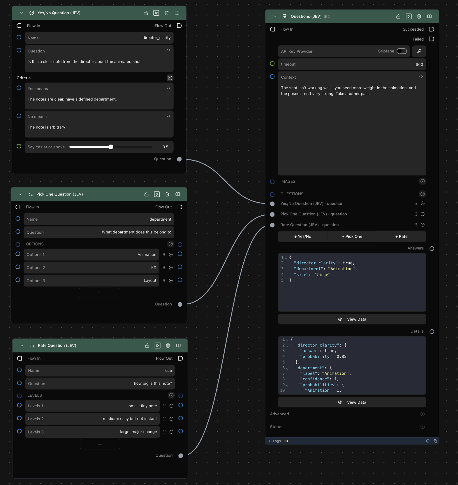

## When to use it

You have some text, and optionally images, and several questions about it. Asking each question with its own node sends the text to JEV once per question and bills it once per question. This node sends it once, asks every question in the same call, and gives you all the answers together.

The questions can be a mix of yes/no, pick-one and rating. You build each question with a small node, connect them to this one, and run it. The answers come back as a dictionary, with each answer under the name you gave its question.

This node has no flow output for each answer. To branch on an answer, read it out of `answers` and send it to a Switch, or to [IfElse](../execution/IfElse.md) for a yes/no. To route on a single question, [Ask Yes/No (JEV)](JevAskYesNo.md), [Pick One (JEV)](JevPickOne.md) and [Rate (JEV)](JevRate.md) each have their own flow outputs.

## How to use it

1. Put your text in `context`, connect images, or both.
2. Add a question. Click **+ Yes/No**, **+ Pick One** or **+ Rate** on the node. Each click adds a question node beside this one and connects it to the next row of `questions`. You can also drag the question nodes in from the library (Classification, Questions) and connect each one's `question` output to a row of `questions`.
3. Fill in each question node: give it a **Name**, write the question, and describe its criteria, options or levels. See [Yes/No Question (JEV)](JevYesNoQuestion.md), [Pick One Question (JEV)](JevPickOneQuestion.md) and [Rate Question (JEV)](JevRateQuestion.md).
4. Run the node.
5. Read the results from `answers`, or from `details` if you want probabilities and confidence. Use [Dictionary Get Value By Key](../dict/DictGetValueByKey.md) to pull one answer out by its name.

## Example

The picture shows a note from a director about an animated shot. Three questions are asked about it in one call: is it a clear note, which department is it for, and how big is the change.



- `director_clarity` is a Yes/No Question. Its criteria say what counts as Yes and as No.
- `department` is a Pick One Question with the options Animation, FX and Layout.
- `size` is a Rate Question with three levels: small, medium and large.

The node returned these answers:

```json
{
  "director_clarity": true,
  "department": "Animation",
  "size": "large"
}
```

`details` holds the full result for each question:

```json
{
  "director_clarity": { "answer": true, "probability": 0.85 },
  "department": {
    "label": "Animation",
    "description": "",
    "confidence": 1,
    "probabilities": { "Animation": 1, "FX": 0, "Layout": 0 }
  },
  "size": {
    "level": 3,
    "score": 2.8,
    "label": "large",
    "description": "major change",
    "confidence": 0.8,
    "probabilities": { "1": 0, "2": 0.2, "3": 0.8 }
  }
}
```

The numbers for `size` are an example of the shape. A rating's `score` is the average of the levels weighted by their probabilities, counting from 1, so it falls between levels. `level` is the score rounded to the nearest level, and `probabilities` is keyed by level number.

Any text field on the question nodes can hold JSON: the question, Yes means and No means, option descriptions and rating levels. A JSON rubric helps most when two options overlap, such as FX and Comp for a shot note. See [Writing options as JSON](JevPickOne.md#writing-options-as-json).

## What it needs

- A Griptape Nodes license or a Griptape Cloud API key (`GT_CLOUD_API_KEY`). To use your own TypeSafe key (`TYPESAFE_API_KEY`) instead, set **API Key Provider** to **Customer**.
- The node waits for the result. `timeout` sets how long, 600 seconds by default, or 0 for no limit. If a run times out, the **Refresh** button on the node fetches the result later.
- Text in `context`, images, or both. The node fails if both are empty.
- At least one question, each with its own **Name**. Two questions with the same name fail the node.
- Images are resized to fit JEV's limits of 280 to 1568 pixels per side. They are saved as JPEG, and transparency is flattened onto white. The encoded images must total under 30 MiB, counting an image once for each time the context or a question names it. Otherwise the node fails.

## Parameters

### context

The text JEV reads. JSON also works. It can be empty if you connect images. Every question is asked about this same text.

### images

Optional images. Name them in the context or in a question as `[image 1]`, `[image 2]` and so on. Numbering counts connected images only, so empty rows are skipped.

Every question sees every connected image, whether or not it names it. Naming an image in the context or in a question points JEV at it.

An image whose aspect ratio is too extreme to fit the size limits raises an error that tells you to crop it.

### questions

One row for each question. Connect the `question` output of a Yes/No Question, Pick One Question or Rate Question node to a row. The **+ Yes/No**, **+ Pick One** and **+ Rate** buttons below the list add a question node and connect it for you, placing it to the left of this node.

Empty rows are ignored.

A question node added with a button is given a name such as `yes_no_1`, `pick_one_1` or `rate_1`, so renaming the node on the canvas does not change its answer's name. A question node dragged in from the library with an empty **Name** uses the node's own name, and renaming that node changes the name its answer appears under. Give it a **Name** if other nodes read the answer.

### answers

Each question's answer, under the question's name.

- A yes/no question gives `true` or `false`.
- A pick-one question gives the label of the option JEV picked.
- A rating question gives the label of the level JEV scored. A level with no label of its own is called `Level 1`, `Level 2` and so on, counting from the lowest.

### details

Each question's full result, under the question's name.

- A yes/no question gives `answer` and `probability`, JEV's probability that the answer is yes.
- A pick-one question gives `label`, `description` (empty if the option had none), `confidence` and `probabilities`, keyed by label.
- A rating question gives `level` (from 1), `score` (JEV's score from 1, which can fall between levels), `label`, `description`, `confidence` and `probabilities`, keyed by level number.

### model

In the collapsed Advanced group. `jev-latest` is the newest stable model and `jev-preview` is the newest release. Models your license does not allow are marked.
